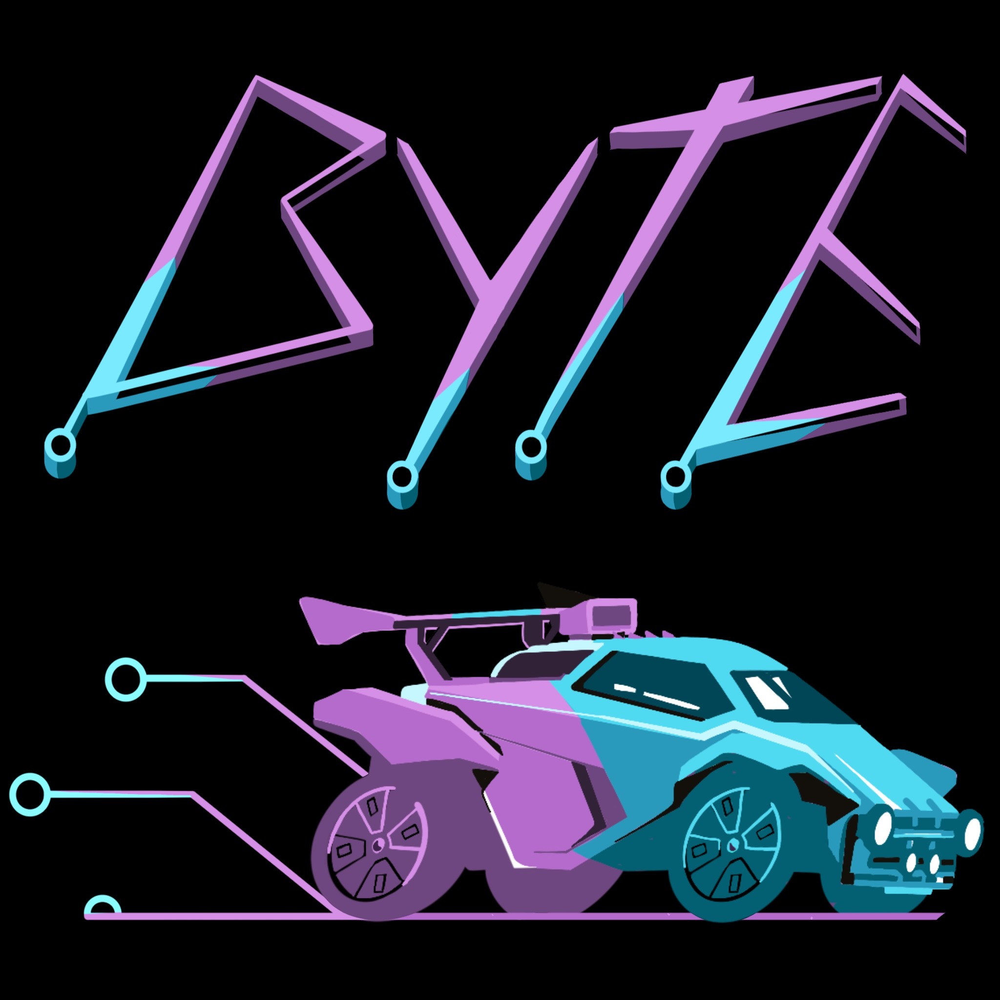

# ByteBotpack



Byte, Kilobyte and Megabyte for **RLBot v5**, with an optional rank selector. Supports 1v1, 2v2 and 3v3.

## Play

Add `rlbot/bot.toml` from a built package to RLBot. Keep the complete bot folder
together. The default is full-strength Megabyte with the selector enabled.
Choose Byte, Kilobyte or Megabyte at full strength, or Select Skill for estimated
Bronze I through SSL difficulty. Auto tries to keep the score even. Changes apply with **Apply &
respawn**.

GPU inference is the default. The build expects libtorch to be at
`%LOCALAPPDATA%/RLBot5/bots/libtorch`, or set `LIBTORCH_CUDA_ROOT` to its directory.

## Run without the selector

By default, the selector window opens when the bot is started. To disable this, edit this line in `rlbot/bot.toml`:

```toml
run_command = "GGLBot.exe --manual=Off" # Options: Off, Byte, Kilobyte, Megabyte
```

Off launches the GUI with the bot. Byte, Kilobyte, and Megabyte each launch their respective bot without the GUI and they run at full strength.

Rank labels are provisional estimates, not verified human ranks.

## Build for the botpack

This repository contains runtime and build sources, the GUI, logo and three
inference model pairs. Build machines need bob, Docker with Linux containers, Python 3.10+, and the
complete Windows LibTorch SDK matching the runtime.

Use the following script to build the bot:
```text
python scripts/build_bob.py --bob "path/to/bob.exe"
```

The result is created at `bob_build/ByteBotpack/` in this repository. By default, the
helper temporarily stages SDK headers and import libraries in
`build-support/libtorch/local/` and removes that generated copy when it finishes.
Use `--work-dir "path/to/scratch"` for an isolated build snapshot, `--out-dir` to
change the output directory, or `--libtorch "path/to/libtorch"` to change the libtorch location.

The six inference files are grouped under `rlbot/models/byte`, `kilobyte` and
`megabyte`. Their checksums are in the [model manifest](rlbot/models/manifest.json).